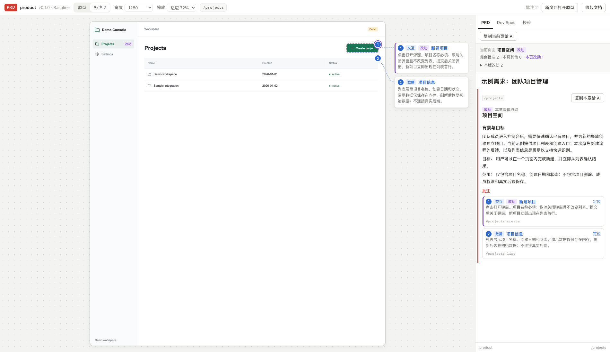

# 前端原型与 PRD 批注 Skill

把已有产品前端抽离成一个可运行的交互原型：保留真实页面和交互，用本地假数据隔离后端，再在右侧关联中文 PRD、研发说明和可定位批注。

适合产品经理制作研发评审原型，也适合编码 Agent 根据 PRD 修改页面。

## 使用

把本仓库作为 Skill 提供给支持标准 `SKILL.md` 的编码 Agent。核心说明见 [SKILL.md](SKILL.md)，可运行脱敏模板在 [assets/template](assets/template)。

```bash
node scripts/create-prototype.mjs ./my-prototype
cd ./my-prototype
npm install
npm run dev -- --host 127.0.0.1 --port 7790
```

打开 `http://127.0.0.1:7790/prd.html#/projects` 查看原型和 PRD 外壳。模板默认是 Baseline 空批注；运行 `npm run demo:annotations` 可以载入批注示例。

## 评审示例

下面是同一套原型加载示例 PRD 后的实际页面：左侧可交互，右侧说明背景、目标、范围，并用两条批注对应新建按钮和项目列表。



截图对应的文档在 `assets/template/examples/annotated/`。运行 `npm run demo:annotations` 可在本地切换到该示例；运行 `npm run demo:baseline` 可恢复空白 Baseline。示例只使用本地内存数据。

## 约定

- 保留源前端 UI，不按截图重新绘制。
- API、登录、支付和写入行为使用本地演示数据，不连接真实后端。
- PRD 与 Dev Spec 使用 Markdown；页面元素通过 `data-prd` 锚点和 PRD 中的 `{#anchor}` 关联。
- 这是脱敏模板，不包含任何公司品牌、真实凭据、业务数据或后端实现。
